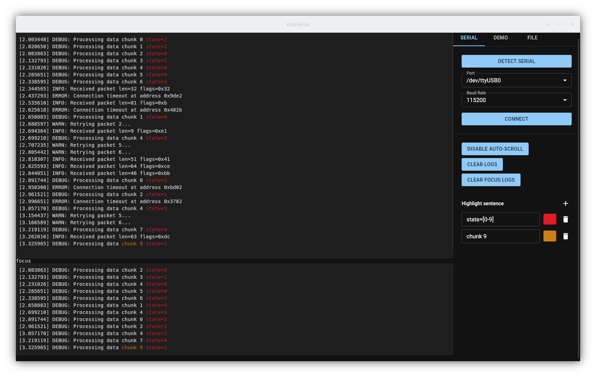

# Kaze Serial

**A modern serial terminal with advanced, yet easy, on the fly, highlighting features !**

Kaze Serial is a modern, high-performance serial terminal application built with **Tauri**, **Next.js**, and **React**. It provides a sleek interface for monitoring serial ports, with advanced log exploration features



## Features

- **Serial Connectivity**:
  - Automatic detection of available serial ports.
  - Configurable baud rates (9600 to 921600).
  - Automatic reconnection when the device resets or is unplugged, even if it comes back under another port name.
- **Log files**: open a log file, or follow it as it grows (`tail -f`), from the **File** tab.
- **High-Performance Logging**:
  - Virtualized log list (using `react-window`) to handle large amounts of data efficiently.
  - Auto-scroll with pause-on-hover/scroll-up capability.
  - Clicking on a row of focus view will scroll the main log view to this element
  - Optional line numbers, as in a code editor.
  - Optional timestamps (reception time), with a configurable format, optionally shown only after a pause in the logs
  - Optional highlight of new lines, fading out
- **Advanced Analysis**:
  - **Highlighting**: Define custom search patterns to highlight specific log messages with custom colors. Patterns can be:
    - Simple search
    - Case sensitive search
    - Regexp search
    - Entire line selection
  - **Split View**: A secondary "Focus" terminal to isolate matched logs or view different parts of the stream.
  - **Sentence removal**: Remove garbage by sentence matching 
  - **Search** (Ctrl+F): find text or a regex in the main log
  - **Markers** (Ctrl+M): insert numbered `MARK` lines to delimit parts of the logs, at the end or above any line (button shown when hovering it)
- **Export/import**:
  - **export**: 
    - Export raw log (without highligh and sentence removal applied) to a file
    - Export the patterns for future use
  - **import**: 
    - Re-import previous log file (File tab)
    - Re-import previous patterns 
- **AI agent access (MCP)**: Expose the live log buffer to an AI agent over an embedded MCP server, so it can read the same lines you see while you debug. See [AI agent access (MCP)](#ai-agent-access-mcp).
- **Cross-Platform**: Runs on Linux and windows, not tested so far on macOS (powered by Tauri).

## Tech Stack

- **Frontend**: [Next.js](https://nextjs.org/) (React), TypeScript, [Material UI](https://mui.com/).
- **Backend**: [Tauri](https://tauri.app/) (Rust) for system interaction and serial port management.
- **State Management**: React Hooks + Tauri Commands.

## Getting Started

### Prerequisites

- **Node.js** (v18+ recommended): [Download node.js](https://nodejs.org/en/download)
- **Rust** (latest stable) & Cargo: [Dowload rust](https://rust-lang.org//tools/install/)
- System dependencies for Tauri (see [Tauri Prerequisites](https://tauri.app/v1/guides/getting-started/prerequisites))

   ```bash
    sudo apt-get install libgtk-3-dev libglib2.0-dev libsoup-3.0-dev libwebkit2gtk-4.1-dev libudev-dev
   ```

### Installation

1. Clone the repository:
   ```bash
   git clone https://github.com/simon0356/KazeSerial.git
   cd KazeSerial
   ```

2. Install frontend dependencies:
   ```bash
   npm i @tauri-apps/cli
   npm install
   ```

### Development

To run the application in development mode (with hot-reloading for both frontend and Rust backend):

```bash
npm run tauri dev
```

### Build

To build the application for production:

```bash
npm run tauri build
```

The output binary/installer will be located in `src-tauri/target/release/bundle/`.

## AI agent access (MCP)

Kaze Serial can expose its log buffer to an AI coding agent through an [MCP](https://modelcontextprotocol.io)
server embedded in the app. The agent reads **the same buffer you are looking at**, so you can ask
it to dig through a capture while you keep reproducing the bug.

### Enabling it

In the **Config** tab of the settings panel, check **Enable MCP server**. The server listens on
port `9339` by default; change it in the **Port** field next to the checkbox (a running server
restarts on the new port). The server binds to loopback only, and the app shows its URL under the
checkbox and prints it into the log:

```
[09:03:25] KazeSerial: MCP server listening on http://127.0.0.1:9339/mcp
```

Then register it with your agent — for Claude Code:

```bash
claude mcp add --transport http kazeserial http://127.0.0.1:9339/mcp
```

The server is never started automatically from the settings: it is off at each launch. To start it
at launch instead of checking the box, set `KAZESERIAL_MCP_PORT`
(use `0` to let the OS pick a free port):

```bash
KAZESERIAL_MCP_PORT=9339 kazeserial
```

### Tools

| Tool | Purpose |
| :- | :- |
| `get_status` | Log source, line count, oldest/newest line id. The orientation call — its ids are the cursors the other tools take. |
| `tail_logs` | The most recent lines, like `tail -n`. |
| `search_logs` | Substring or regex search with optional context lines. The cheapest way into a large capture. |
| `get_logs_range` | Every line between two ids, to zoom in around a hit. |
| `get_focus_logs` | Only the lines your own "focus" highlight rules matched — high signal. |
| `get_all_logs` | The complete buffer, paginated. |
| `wait_for_logs` | Blocks until lines newer than a given id arrive, so the agent can follow a live capture without polling. |
| `wait_for_pattern` | Blocks until a line matching a substring or regex arrives, instead of sleeping a fixed duration. |
| `clear_logs` | Clears the buffer in both the agent's view and your window. The only tool that writes anything. |

Line text is always the **raw** line, with no highlight markup. Nothing in this interface can write
to the serial port.

### Notes

- The buffer is a ring of 500 000 lines; override with `KAZESERIAL_LOG_CAPACITY`. `get_status`
  reports how many lines have been evicted.
- The server listens on `127.0.0.1` only, and validates the `Host` header against loopback names.
  Any other local process can still read your logs while it is running, so leave it off when you
  do not need it.

## Configuration

- **Highlights**: Highlight settings are automatically saved to `highlight_settings.json` in the application configuration directory.
- **Application settings**: Config tab settings (line numbers, timestamps, new line highlight, serial auto-reconnect, MCP server port) are saved to `app_config.json` in the same directory.
- **MCP server**: Off by default, started from the Config tab. `KAZESERIAL_MCP_PORT` starts it at launch; `KAZESERIAL_LOG_CAPACITY` sets the number of lines kept in memory.

## Background
Since I work as an embedded software developper, most of my work time consist of looking on serial monitor for debug purpose.
I used to work a lot with minicom and more recently with [Serial Monitor Rust](https://github.com/hacknus/serial-monitor-rust).
Highlight features on Serial Monitor Rust was not his main purpose and i'm not so confident with EGUI framework.  
Since I wanted to learn React, i did this simple project, and of course Copilot and LLM agent help me a lot for bootstraping this project

## License

[MIT](LICENSE)


## Contributor : 
[JackHerRrer](https://github.com/JackHerRrer)
